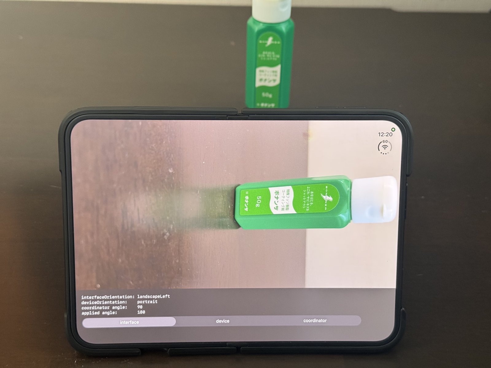
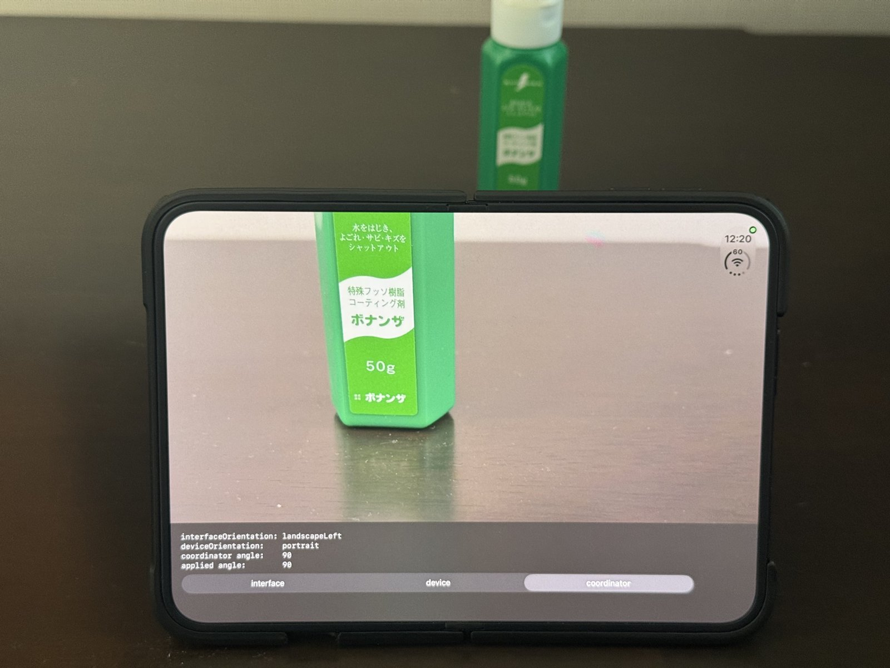

# DuoCameraRotation

[English](README.md)

iPhone Duo の内側画面でカメラのプレビューが 90 度回転する現象を再現し、修正方法と比べるための最小プロジェクト。

画面下の切替で、プレビューの回転角を決める方式を選べる。

| 方式 | 回転角の決め方 |
| --- | --- |
| `interface` | 画面の向き (`UIWindowScene.interfaceOrientation`) を `AVCaptureConnection.videoOrientation` に設定する |
| `device` | 端末の向き (`UIDevice.current.orientation`) に対応する固定の角度を `AVCaptureConnection.videoRotationAngle` に設定する |
| `coordinator` | `AVCaptureDevice.RotationCoordinator.videoRotationAngleForHorizonLevelPreview` を `AVCaptureConnection.videoRotationAngle` に設定する |

実装は [CameraPreview.swift](DuoCameraRotation/CameraPreview.swift) の `applyRotation()` にある。

## 実機での結果

iPhone Duo の背面カメラで確認した。「必要な角度」は `RotationCoordinator` が返した値。方式の列は、その方式が `videoRotationAngle` に適用した角度。適用した角度が必要な角度と一致した組み合わせでは映像が正しい向きで表示され、一致しなかった組み合わせ (太字) では向きがずれた。

内側画面を横向きで使い、同じ対象物を写したときの比較。左が `interface`、右が `coordinator`。

| `interface` | `coordinator` |
| --- | --- |
|  |  |

### 外側画面

| 画面の向き | 端末の向き | 必要な角度 | `interface` | `device` | `coordinator` |
| --- | --- | --- | --- | --- | --- |
| portrait | portrait | 90 | 90 | 90 | 90 |
| landscapeLeft | landscapeRight | 180 | 180 | 180 | 180 |
| landscapeRight | landscapeLeft | 0 | 0 | 0 | 0 |
| portrait | portraitUpsideDown | 90 | 90 | **270** | 90 |
| landscapeLeft | portraitUpsideDown | 180 | 180 | **270** | 180 |
| landscapeRight | portraitUpsideDown | 0 | 0 | **270** | 0 |
| portrait | faceUp, faceDown | 90 | 90 | 90 | 90 |
| landscapeLeft | faceUp, faceDown | 180 | 180 | **90** | 180 |
| landscapeRight | faceUp, faceDown | 0 | 0 | **90** | 0 |

外側画面は portraitUpsideDown に回転しない。端末を上下逆さまに持つと、画面の向きは直前の値のまま、端末の向きだけが portraitUpsideDown になる。

### 内側画面

| 画面の向き | 端末の向き | 必要な角度 | `interface` | `device` | `coordinator` |
| --- | --- | --- | --- | --- | --- |
| portrait | landscapeLeft | 0 | **90** | 0 | 0 |
| landscapeLeft | portrait | 90 | **180** | 90 | 90 |
| portraitUpsideDown | landscapeRight | 180 | **270** | 180 | 180 |
| landscapeRight | portraitUpsideDown | 270 | **0** | 270 | 270 |
| portrait | faceUp, faceDown | 0 | **90** | **90** | 0 |
| landscapeLeft | faceUp, faceDown | 90 | **180** | 90 | 90 |
| portraitUpsideDown | faceUp, faceDown | 180 | **270** | **90** | 180 |
| landscapeRight | faceUp, faceDown | 270 | **0** | **90** | 270 |

### 読み取れること

- 内側画面では、画面の向きと端末の向きの対応が外側画面と 90 度ずれている。画面が portrait のとき、端末の向きは landscapeLeft になる。
- `interface` は、内側画面のすべての組み合わせで 90 度ずれる。
- `device` は、端末を立てて持つ限り内側画面でも正しい向きになる。外側画面で端末を上下逆さまに持った場合と、平置き (faceUp, faceDown) で画面が既定の向きでない場合にずれる。この実装は平置きのとき常に 90 度を適用する。
- `coordinator` は、測定したすべての組み合わせで正しい向きになる。

## 動かし方

1. `DuoCameraRotation.xcodeproj` を Xcode で開く。
2. ターゲットの Signing & Capabilities で署名チームとバンドル ID を設定する。
3. 実機にビルドする。シミュレータにはカメラがないため再現できない。

## 環境

- iPhone Duo (iOS 27.2.1), Xcode 27.2
- iOS 17.0 以降 (`RotationCoordinator` の要件)

## ライセンス

[MIT](LICENSE)
