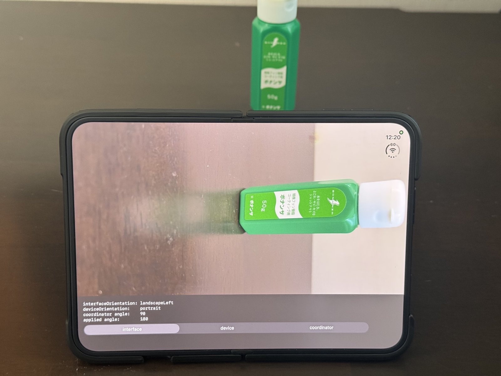
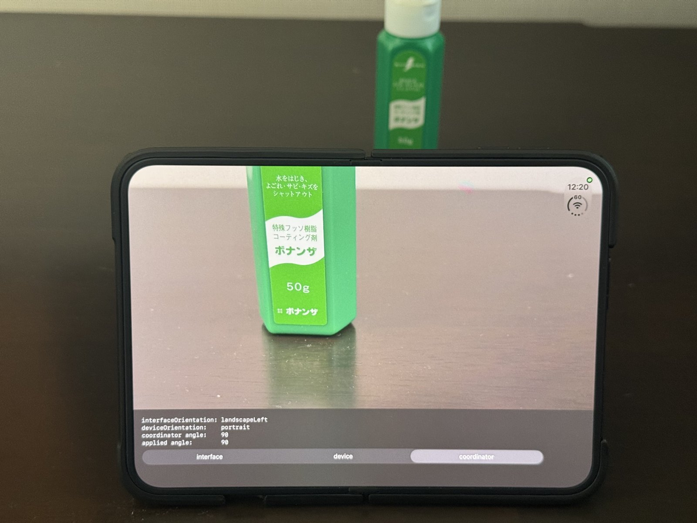

# DuoCameraRotation

[日本語](README.ja.md)

A minimal project that reproduces the camera preview being rotated by 90 degrees on the inner display of iPhone Duo, and compares the fix against it.

The segmented control at the bottom switches how the preview rotation angle is decided.

| Mode | How the rotation angle is decided |
| --- | --- |
| `interface` | Sets the interface orientation (`UIWindowScene.interfaceOrientation`) to `AVCaptureConnection.videoOrientation` |
| `device` | Sets a fixed angle for each device orientation (`UIDevice.current.orientation`) to `AVCaptureConnection.videoRotationAngle` |
| `coordinator` | Sets `AVCaptureDevice.RotationCoordinator.videoRotationAngleForHorizonLevelPreview` to `AVCaptureConnection.videoRotationAngle` |

The menu above it selects which camera to use (back, front, and so on).

The implementation is in `applyRotation()` in [CameraPreview.swift](DuoCameraRotation/CameraPreview.swift).

## Results on a real device

Measured with the back camera of iPhone Duo. "Required angle" is the value returned by `RotationCoordinator`. Each mode column shows the angle that mode applied to `videoRotationAngle`. When the applied angle matched the required angle, the preview was displayed in the correct orientation. When it did not match (bold), the preview was rotated.

The same subject on the inner display in landscape. `interface` on the left, `coordinator` on the right.

| `interface` | `coordinator` |
| --- | --- |
|  |  |

### Outer display

| Interface orientation | Device orientation | Required angle | `interface` | `device` | `coordinator` |
| --- | --- | --- | --- | --- | --- |
| portrait | portrait | 90 | 90 | 90 | 90 |
| landscapeLeft | landscapeRight | 180 | 180 | 180 | 180 |
| landscapeRight | landscapeLeft | 0 | 0 | 0 | 0 |
| portrait | portraitUpsideDown | 90 | 90 | **270** | 90 |
| landscapeLeft | portraitUpsideDown | 180 | 180 | **270** | 180 |
| landscapeRight | portraitUpsideDown | 0 | 0 | **270** | 0 |
| portrait | faceUp, faceDown | 90 | 90 | 90 | 90 |
| landscapeLeft | faceUp, faceDown | 180 | 180 | **90** | 180 |
| landscapeRight | faceUp, faceDown | 0 | 0 | **90** | 0 |

The outer display does not rotate to portraitUpsideDown. When the device is held upside down, the interface orientation keeps its previous value and only the device orientation becomes portraitUpsideDown.

### Inner display

| Interface orientation | Device orientation | Required angle | `interface` | `device` | `coordinator` |
| --- | --- | --- | --- | --- | --- |
| portrait | landscapeLeft | 0 | **90** | 0 | 0 |
| landscapeLeft | portrait | 90 | **180** | 90 | 90 |
| portraitUpsideDown | landscapeRight | 180 | **270** | 180 | 180 |
| landscapeRight | portraitUpsideDown | 270 | **0** | 270 | 270 |
| portrait | faceUp, faceDown | 0 | **90** | **90** | 0 |
| landscapeLeft | faceUp, faceDown | 90 | **180** | 90 | 90 |
| portraitUpsideDown | faceUp, faceDown | 180 | **270** | **90** | 180 |
| landscapeRight | faceUp, faceDown | 270 | **0** | **90** | 270 |

### Findings

- On the inner display, the mapping between interface orientation and device orientation is shifted by 90 degrees compared with the outer display. When the interface is portrait, the device orientation is landscapeLeft.
- `interface` is off by 90 degrees in every combination on the inner display.
- `device` is correct on the inner display as long as the device is held upright. It is wrong when the device is held upside down on the outer display, and when the device lies flat (faceUp, faceDown) while the interface is not in its default orientation. This implementation always applies 90 degrees when the device lies flat.
- `coordinator` is correct in every measured combination.

## How to run

1. Open `DuoCameraRotation.xcodeproj` in Xcode.
2. Set your signing team and bundle identifier in Signing & Capabilities of the target.
3. Build to a real device. The simulator has no camera, so the issue cannot be reproduced there.

## Environment

- iPhone Duo (iOS 27.2.1), Xcode 27.2
- iOS 17.0 or later (required by `RotationCoordinator`)

## License

[MIT](LICENSE)
